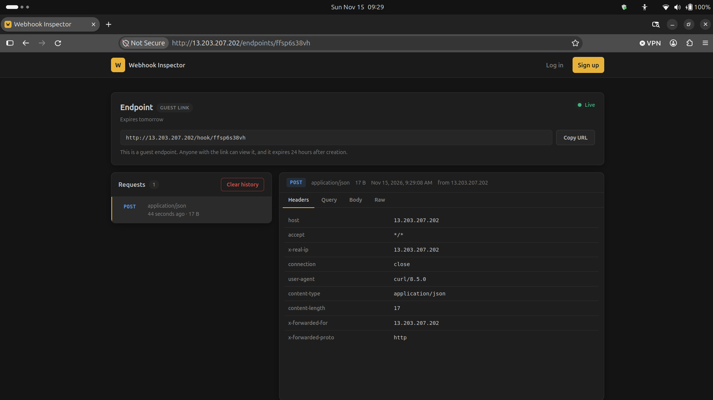

# Webhook Inspector

A small webhook.site-style tool. It gives you a unique URL, captures every HTTP request sent to it, and shows those requests live in a dashboard.
Built as a learning project for backend development and deployment.




## Features

- Create an endpoint and get a unique hook URL (no account needed)
- Captures any HTTP method and content type: headers, query, body, IP and size
- Live dashboard that updates as requests arrive (Server-Sent Events)
- Request history with pagination, and a clear-history button
- Optional accounts (bcrypt + JWT): owned endpoints last 30 days, guest endpoints last 24 hours
- Background processing with a BullMQ queue and a worker, so the hook URL answers fast
- Rate limits, body size limits and automatic cleanup of expired data
- Deployed on an AWS EC2 server and served over its public IP, with only ports 22 (SSH) and 80 (HTTP) open

## Tech stack

| Part | Technology |
|---|---|
| Backend | Node.js, Express, TypeScript |
| Database | PostgreSQL |
| Queue and live events | Redis, BullMQ |
| Frontend | React, Vite, Tailwind CSS |
| Packaging | Docker, Docker Compose |
| Web server | Nginx |
| Deployment | AWS EC2 (Ubuntu 24.04, t3.small), AWS Free plan |
| Networking | EC2 public IP, security group allowing ports 22 and 80 |

## How it works

```
Sender ──► Nginx ──► API ──► Redis queue ──► Worker ──► PostgreSQL
                      ▲                          │
                      └─── Redis Pub/Sub ◄───────┘
                      │
                      └──► live stream (SSE) ──► Browser
```

1. A request arrives at `/hook/<id>`.
2. The API checks the endpoint exists, puts the request on a queue, and replies `200`.
3. The worker saves it to PostgreSQL and publishes a live event.
4. The API pushes the event to every browser watching that endpoint.

## Project structure

```
backend/     API and worker (TypeScript)
frontend/    React dashboard
nginx/       Nginx config and Dockerfile
docs/        Deployment guide
docker-compose.yml       Full stack
docker-compose.dev.yml   Postgres and Redis only (for development)
```

## Run it locally (Docker)

You need Docker with Docker Compose.

```bash
cp .env.example .env
```

Edit `.env`:

- Set `POSTGRES_PASSWORD`, and use the same password inside `DATABASE_URL`.
- Set `JWT_SECRET` to the output of `openssl rand -hex 32`.
- Keep `PUBLIC_URL=http://localhost` and `COOKIE_SECURE=false`.

Start everything from the repository root:

```bash
docker compose up -d --build
docker compose ps
```

When `db`, `redis`, `api` and `web` are healthy, open <http://localhost>.

Send a test request to the hook URL shown on the page:

```bash
curl -X POST 'http://localhost/hook/<ENDPOINT_ID>' \
  -H 'Content-Type: application/json' \
  -d '{"hello":"world"}'
```

It should appear live in the dashboard.

Useful commands:

```bash
docker compose logs -f api worker   # follow logs
docker compose down                 # stop, keep the database
docker compose down -v              # stop and DELETE the database
```

## Develop without Docker for the app

Run only Postgres and Redis in Docker, and the app on your machine:

```bash
docker compose -f docker-compose.dev.yml up -d

cd backend
cp .env.example .env      # uses localhost for the database and Redis
npm install
npm run dev               # API on http://localhost:3000
npm run dev:worker        # worker, in a second terminal
npm test                  # automated tests
```

Frontend, in another terminal:

```bash
cd frontend
npm install
npm run dev               # http://localhost:5173
```

Note: `backend/.env` and the root `.env` are different files on purpose. The backend on your machine reaches Postgres at `localhost`, while containers reach it at `db`.

## API overview

| Method | Route | Purpose |
|---|---|---|
| POST | `/api/auth/register` | Create an account |
| POST | `/api/auth/login` | Log in (returns an access token, sets a refresh cookie) |
| POST | `/api/auth/refresh` | Get a new access token |
| POST | `/api/auth/logout` | Log out |
| POST | `/api/endpoints` | Create an endpoint (guest or logged in) |
| GET | `/api/me/endpoints` | List your endpoints |
| GET | `/api/endpoints/:id` | Endpoint info |
| GET | `/api/endpoints/:id/requests` | Request history |
| DELETE | `/api/endpoints/:id/requests` | Clear history |
| POST | `/api/endpoints/:id/stream-ticket` | Short-lived ticket for the live stream |
| GET | `/api/endpoints/:id/stream` | Live stream (SSE) |
| ANY | `/hook/:id` | Capture a request |
| GET | `/api/health` | Health check |

## Current limitations

- HTTP only for now, so use throwaway passwords on a deployed copy.
- No HTTPS, CI/CD or automated backups yet.
- Rate-limit counters are kept in memory, so they reset when the API restarts.